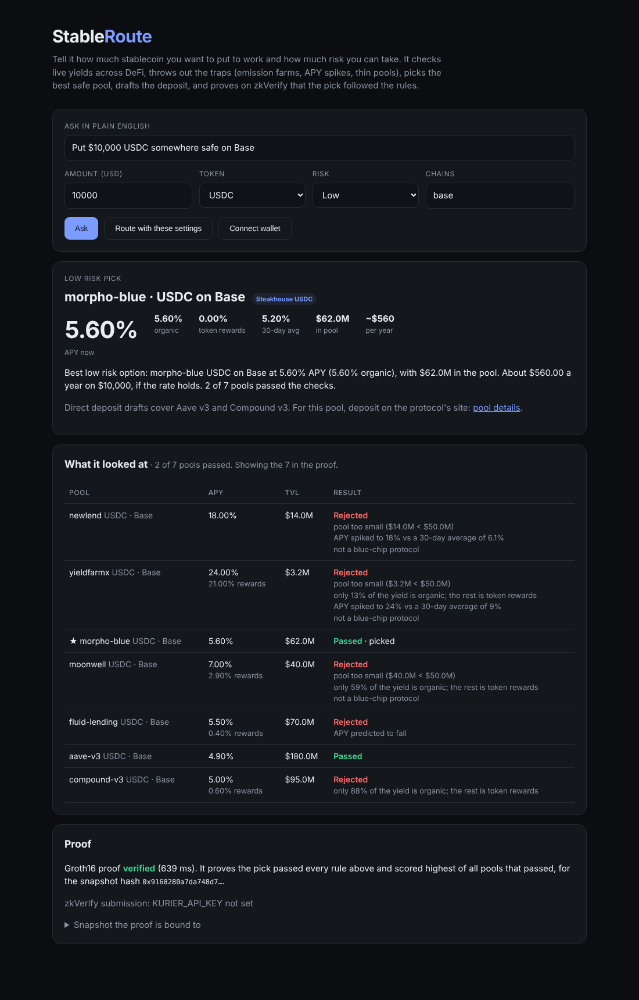

# StableRoute

**A stablecoin yield router that shows its work.** Tell it how much USDC/USDT/DAI you want to put to work and how much risk you can take. It checks live yields across DeFi, throws out the traps, picks the best pool that passes its risk rules, drafts the deposit for your wallet, and proves on zkVerify that the pick really followed those rules.

Entry for **zkVerify Agent Games 2026, Event 03: Wildcard** (DeFi).

- **Live demo:** https://www.stableroute.xyz/
- **Agent endpoint:** `POST https://www.stableroute.xyz/agent` (HMAC-signed, Agent Games protocol v1)
- **Public API:** `POST /route`, `POST /ask`, `GET /health`



---

## The problem

Anyone holding stablecoins faces the same question: *where do I earn yield without getting wrecked?* The yield dashboards list thousands of pools sorted by APY, and the top of that list is usually the worst place to be:

- **Emission farms:** 20%+ APY where most of it is paid in a farm token that is dumping.
- **APY spikes:** a pool showing 18% today that averaged 6% this month, often from a one-off incentive or a utilization spike that won't last.
- **Thin pools:** a $3M pool where your deposit moves the rate and you can't get out fast.
- **Unknown protocols:** new contracts with no track record.

People either chase the headline number and get burned, or give up and leave stablecoins idle. Robo-advisors that *do* pick for you are black boxes: "trust us, this is the safe one."

## Who it helps

- **Stablecoin holders** (including the many people in markets like Nigeria who hold USDT/USDC as savings) who want a sensible yield without reading forty dashboards.
- **DAOs and small treasuries** that need a defensible, written-down reason for where idle funds went.
- **Other agents and wallets** that want a machine-readable "where should this USDC go?" answer with a proof attached.

## What it does

```
"Put $10,000 USDC somewhere safe on Base"
        │
        ├─ parse intent (rules, or Claude if ANTHROPIC_API_KEY is set; the LLM never decides)
        ├─ fetch live pools from the DeFiLlama yields API
        ├─ keep single-asset stablecoin pools on the requested chains and token
        ├─ apply the risk policy (6 checks, below) to every pool
        ├─ pick the highest risk-adjusted score among pools that pass
        ├─ draft the deposit (ERC-20 approve + Aave v3 supply / Compound v3 supply)
        ├─ Groth16 proof: "the pick passed every check and beat every other passing pool"
        └─ submit the proof to zkVerify through Kurier
        ▼
{ decision: ROUTE | NO_SAFE_ROUTE, pick, shortlist with reasons, deposit txs, proof, zkVerify job }
```

### The risk policy

| Check | Low | Medium | High |
|---|---|---|---|
| Minimum pool size (TVL) | $50M | $10M | $1M |
| Your deposit as a share of the pool, max | 1% | 2% | 5% |
| Share of APY that must be organic (not token emissions) | 90% | 70% | 30% |
| Current APY vs 30-day average, max | 1.5× | 2× | 2.5× |
| Blue-chip protocols only (Aave, Compound, Morpho, Spark, Sky, Fluid, Euler, Maple) | yes | no | no |
| Skip pools DeFiLlama predicts will fall | yes | yes | no |

**Score** = 2 × organic APY + reward APY. Emission rewards count half because they are paid in a volatile token and often switch off.

If nothing passes, the agent says so (`NO_SAFE_ROUTE`) and proves that too, instead of forcing a bad pick.

## What the proof establishes (and what it doesn't)

The circuit (`circuits/route_decision.circom`, ~5k constraints) takes a shortlist of 8 pools and the policy. zkVerify accepts at most 16 public signals for Groth16, so the pool figures are private inputs bound by an in-circuit **Poseidon hash** (`dataHash`, public) of the packed pool rows plus the snapshot hash. The policy and decision are public. 12 public signals in total. Every response includes the full snapshot, so anyone can recompute `dataHash` (`src/commit.js`) and re-run the rules. It proves:

1. The picked pool passes all six checks, using exactly these policy numbers.
2. Its score is greater than or equal to the score of **every** pool in the shortlist that passes.
3. If nothing was picked, then **no** pool in the shortlist passed.
4. All of this is bound to `dataHash`: Poseidon over the 8 packed pool rows and the SHA-256 of the published snapshot. The server recomputes it on every run and reports `dataHashMatchesSnapshot`.

The tests show that a "lying" decision cannot be proven: picking the emission farm fails, and so does picking a pool that passes but isn't the best.

**What it does not prove:** that DeFiLlama really returned those numbers (the data source is trusted; a zkTLS attestation of the API response is the natural next step), or how the 8-pool shortlist was cut from the full list. The shortlist is the 4 best passing pools plus the highest-yield pools that failed, so the proof shows both the pick and the traps it turned down. Both steps are deterministic and reproducible from the published snapshot. The trusted setup was run locally by a single contributor, which is fine for a demo but should become a multi-party ceremony in production.

## Safety

- **Non-custodial.** StableRoute never holds keys or funds. It returns unsigned transactions; the user reviews and signs each one in their own wallet.
- **Approve exactly the deposit amount**, never unlimited.
- **Fail closed.** Bad input, missing data or a failed check means no route, never a guess.
- **The LLM only parses** the request into parameters. The routing decision is deterministic code, mirrored 1:1 by the circuit.
- Not financial advice. Yields change; smart-contract risk never goes to zero.

## API

```bash
# plain English
curl -X POST https://<host>/ask -H 'content-type: application/json' \
  -d '{"text":"put $10k USDC somewhere safe on Base","wallet":"0xYourAddress"}'

# structured
curl -X POST https://<host>/route -H 'content-type: application/json' \
  -d '{"amount":10000,"token":"USDC","risk":"low","chains":["Base","Arbitrum"],"wallet":"0xYourAddress"}'

# check a proof yourself
curl -X POST https://<host>/verify -d '{"proof":{...},"publicSignals":[...]}'
curl https://<host>/proof-status/<kurierJobId>
```

`wallet` is only needed to draft an Aave deposit (Aave's `supply` takes `onBehalfOf`).

### Agent Games endpoint

`POST /agent` is public when `AGENT_GAMES_HMAC_SECRET` is unset (Wildcard is reviewed by people). When the secret is set it follows the platform protocol: it verifies `x-agent-games-signature` (HMAC-SHA256, hex, over the raw body) before parsing anything, answers preflight with `{ "ok": true, "protocolVersion": "v1" }`, routes task input (`{ amount, risk, token, chains }` or `{ text }`), and signs every response the same way. Unsigned requests get 401.

## Run it

```bash
npm install
npm test                      # 10 end-to-end tests on offline data, incl. "lying decision can't be proven"
cp .env.example .env          # fill in what you need
npm start                     # http://localhost:3000
```

Offline mode: `YIELDS_FIXTURE=test/fixture.json npm start`.

### Deploy (Railway)

1. Push this repo to GitHub, then in Railway choose *New Project → Deploy from GitHub repo*.
2. Add variables: `AGENT_GAMES_HMAC_SECRET`, `KURIER_API_KEY` (and optionally `ANTHROPIC_API_KEY`).
3. *Settings → Networking → Generate Domain.* Your endpoint is `https://<domain>/agent`, health at `/health`.

### Rebuild the circuit

```bash
npx circom2 circuits/route_decision.circom --r1cs --wasm -l node_modules -o build
# then snarkjs powersoftau (2^13) + groth16 setup + zkey export verificationkey
```

## Layout

| Path | What |
|---|---|
| `src/data.js` | DeFiLlama fetch + normalization into circuit units (USD, basis points) |
| `src/policy.js` | Risk tiers, blue-chip list, score, human-readable checks |
| `src/router.js` | Shortlist, pick, snapshot hash, circuit input, explanation |
| `src/txdraft.js` | Approve + Aave v3 / Compound v3 deposit calldata |
| `src/prover.js`, `src/kurier.js` | Groth16 proving + zkVerify submission via Kurier |
| `src/nl.js` | Plain-English parsing (rules, optional Claude) |
| `src/server.js` | HTTP API, demo page, signed Agent Games endpoint |
| `circuits/` | Circuit source, wasm, proving key, verification key |
| `public/index.html` | Demo UI with wallet deposit flow |

## Limits

- Deposit drafts cover Aave v3 and Compound v3 (USDC). Other picks (Morpho vaults, Spark, etc.) link to the pool page.
- Snapshots are kept in memory for recent runs only; the full snapshot is also returned in every response.
- DeFiLlama data is cached for 5 minutes.

Built by [@justdavid0x](https://x.com/justdavid0x). MIT licensed.
